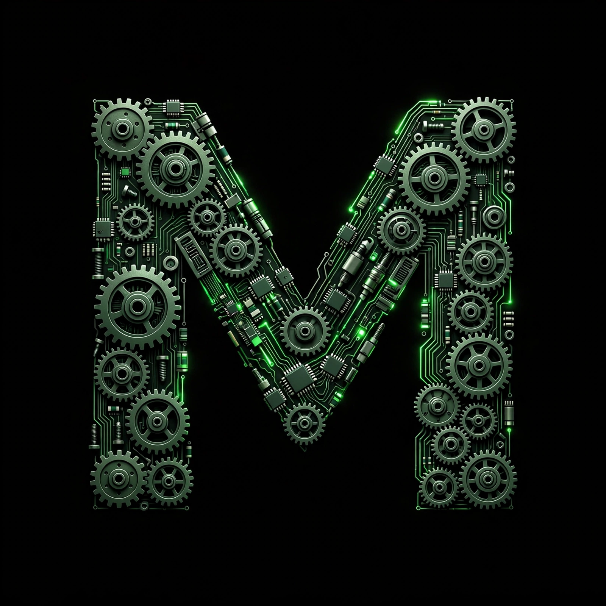

<p align="center">
  
</p>

# MemeMachine
Website: https://machinechain.netlify.app/

A Solana-derived L1 with its own token, its own culture, and apps
running on it — built to be one of the best Solana forks, not just a
rebrand. MemeMachine is the chain the Solana OS runs on.

- **Chain:** MemeMachine (Agave 2.3.13, a real Solana/Agave fork)
- **Token:** **$MACHINE** — the native gas token, 1,000,000,000 supply,
  minted at genesis. See `GENESIS.md` for the hash, the distribution,
  the validator keys, and the fee schedule.
- **Status:** local single-node testnet, voting and finalizing.
  Not a public chain yet — see "Honest limits" and
  `LAUNCH_CHECKLIST.md`.

## What this is

MemeMachine is a real fork of Solana's validator code (Agave) with a
custom genesis: its own chain identity, its own token, its own fee
schedule, and its own validator. It is not a token on Solana mainnet
and not a rebranded testnet — it is a separate chain that produces its
own blocks, votes, and finality.

A Solana-derived L1 with a native token, its own culture, apps, and
a bridge — built from scratch, everything here is original.

## The differentiator: MemeMachine has its own OS

MemeMachine has an **operating
system** as its native apps layer: the Solana OS we built — a desktop OS
in the browser where the chain is the filesystem, blocks are folders,
slots are time, and every app is a native app on the chain.

- **Solana OS** — the native apps layer (Wallet, Rug Shield, Pump
  Radar, x402 Store, MCP Hub, Terminal, Chain Files). It is the
  dashboard and the app platform, not an afterthought.
- **Rug-Farm Registry** — the open rug-checker for pump.fun, running
  as a day-one app on MemeMachine (real v2.17+ detection rules, live
  watcher, hosted API).

Two real apps ship on day one.

## How to run it

Requires: Linux, ~500 MB free for the Agave release, and a host where
UDP send works (see "Honest limits" — the transfer check needs it).

```bash
# 1. Install the prebuilt Agave binaries (no source build, ever)
./install.sh

# 2. Start the validator on the MemeMachine genesis
./start-validator.sh

# 3. In another terminal, check it
./bin/solana slot --url http://127.0.0.1:8899
./bin/solana balance 7ivcPQJ6C7RZAnprKkJHN9o1PrpSjE6iC2mm7RRS3DEz --url http://127.0.0.1:8899
```

`install.sh` downloads the Agave 2.3.13 prebuilt release from GitHub
and extracts `solana`, `solana-keygen`, `solana-genesis`,
`solana-test-validator`, `agave-validator`, and `agave-ledger-tool`
into `bin/`. `start-validator.sh` copies the shipped genesis
(`ledger/`) to a working directory, seeds the bootstrap validator
keypairs, and boots `solana-test-validator` on RPC port 8899.

To regenerate the genesis from scratch instead of using the shipped
one, see `patch-vote-authority.py` — run `solana-genesis` with the
parameters in `GENESIS.md`, then run the patch script so the
test-validator can vote. The shipped `ledger/` is the canonical
genesis; regenerating produces a different hash (new timestamp).

## What makes MemeMachine different

Here is where MemeMachine stands on each point. Shipped means it is
in this repo and verifiable now; NEXT means it is a dated roadmap item,
not a claim.

| Point | MemeMachine |
|---|---|
| 1 validator today | **NEXT — not done yet.** MemeMachine is 1 validator today (local single-node testnet). Multi-validator (3 nodes) is the top roadmap item; it needs a host where the file-descriptor limit can be raised to 1,000,000 and UDP send works. See `LAUNCH_CHECKLIST.md`. |
| Bridge | **NEXT.** Bridge plan is a dated roadmap item (see below). Nothing is claimed as bridged until it is. |
| Wallet support | **Shipped (OS layer).** The Solana OS wallet connect supports Phantom, Solflare, and Backpack (real USDC signing). Chain-level wallet support (wallets adding the MemeMachine network) is NEXT and needs a public RPC endpoint. |
| Day-one ecosystem | **Shipped.** Rug-Farm Registry + Solana OS are day-one apps (above). |
| Distribution | **Shipped (distribution).** MACHINE distribution is published in `GENESIS.md`: founder 998,999,000 / stake 1,000,000 / faucet 1,000. No hidden allocation. Price history doesn't exist yet — the token is not trading. |
| Audit and bug bounty | **NEXT.** Audit + bug bounty are dated roadmap items. |
| Published genesis, fees, whitepaper | **Shipped.** Genesis hash, validator keys, and the full fee schedule are in `GENESIS.md`. This README is the positioning doc; a whitepaper is NEXT. |
| Block speed | **Shipped.** Observed ~3 slots/second on the localnet, confirming and finalizing continuously. |
| Native token as gas from genesis | **Shipped.** MACHINE is the gas token from genesis, distribution in `GENESIS.md`. |
| Technical deltas with measurements | **Shipped (partially).** The vote-authority patch + the localnet measurements (slot rate, confirmation, finalization, vote credits) are documented in `GENESIS.md`. More deltas are NEXT. |

## Roadmap (dated)

| When | Item | Status |
|---|---|---|
| 2026-11-14 | MemeMachine genesis + single-node localnet voting and finalizing | Done (this repo) |
| 2026-11-14 | Genesis hash, validator keys, fee schedule, distribution published | Done (`GENESIS.md`) |
| 2026-11-14 | Rug registry + Solana OS as day-one apps | Done (shipped ecosystem) |
| Next | User transfer verified on a host where UDP send works | NEXT — blocked on this VM (see below) |
| Next | Multi-validator localnet (3 nodes reaching consensus) | NEXT — needs a host with `--ulimit nofile=1000000` and working UDP |
| Next | Public RPC endpoint + wallet network support | NEXT — needs hosting |
| Next | Bridge (Solana mainnet ↔ MemeMachine) for approved SPL assets | NEXT — programs + relayer built locally; needs deployment and audit (see `BRIDGE.md` §5) |
| Next | Audit + bug bounty | NEXT |
| Next | Whitepaper | NEXT |
| Later | Public chain (hosted validators, stake, monitoring) | NEXT — a separate step, not claimed now |

## Honest limits

- **Local single-node testnet, not a public chain.** One validator,
  running on this VM. Making it public needs hosted validators and
  stake, monitoring, and a public RPC — a separate step.
- **1 validator today.** The
  multi-validator upgrade is the top priority and is not done. Do not
  describe MemeMachine as "more decentralized" than other
  single-validator chains until it is.
- **User transfers are not verified on this VM.** The container blocks
  UDP send (`sendto` returns EPERM), which breaks the RPC → TPU
  forwarding that user transactions need. The chain votes, confirms,
  and finalizes (votes are created in-process, so they are unaffected),
  but a transfer between two fresh keypairs has not been confirmed
  here. It is the first thing to verify on a host where UDP works.
  The faucet also fails here (`TransactionDataTooLarge(30061)` on
  every airdrop attempt).
- **No bridge, no audit, no public RPC yet.** All NEXT, all dated
  above. Nothing is claimed until it is proven.
- **The keypairs in `keys/` are dev-only.** They are throwaway test
  keys for this chain. They hold no mainnet value and must be replaced
  before any public or production use.

## Repo layout

| Path | What it is |
|---|---|
| `GENESIS.md` | Chain identity, hash, distribution, validator keys, fee schedule |
| `README.md` | This file |
| `LAUNCH_CHECKLIST.md` | What "best" means — PROVEN vs NEXT, with evidence |
| `install.sh` | Downloads prebuilt Agave 2.3.13 into `bin/` |
| `start-validator.sh` | Boots the validator on the shipped genesis |
| `run-in-ns.sh` | Runs a command with faked sysctl values (for `agave-validator`) |
| `patch-vote-authority.py` | Patches a genesis so `solana-test-validator` can vote |
| `ledger/` | The canonical MemeMachine genesis (genesis.bin + blockstore) |
| `keys/` | Dev-only bootstrap keypairs (founder/vote/stake/faucet) |
| `bin/` | Agave binaries (not committed — `install.sh` fetches them) |
| `ledger-test/` | Working copy of the ledger (not committed — created at runtime) |

## Bridge

Native Rust programs (no Anchor) bridging SPL tokens between Solana and Machine: lock on Solana, mint wrapped 1:1 on Machine via 3-of-5 relayer attestation (verified on-chain through the ed25519 precompile). See [bridge/](bridge/) — 51 program tests passing, plus the off-chain relayer in `bridge/crates/relayer/` (23 tests passing). Local only, not deployed, not audited, nothing has crossed.
