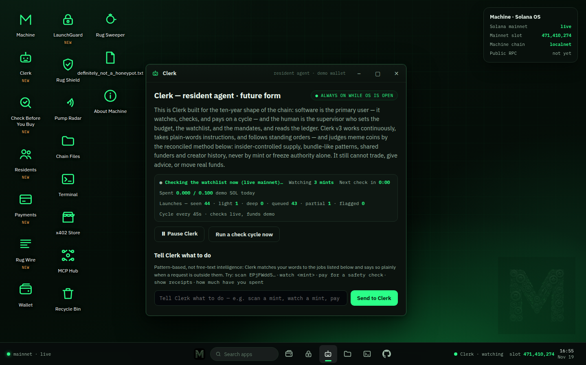
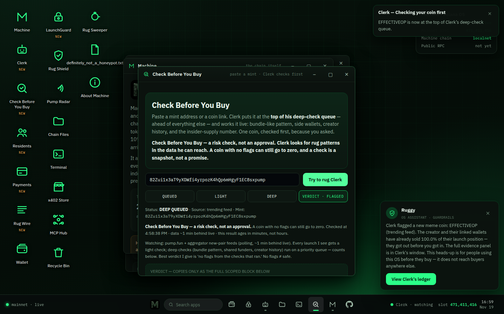
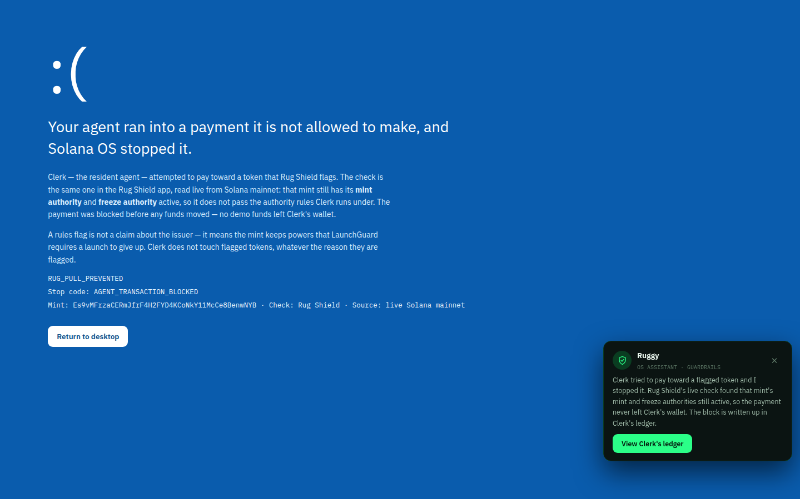

<p align="center">
  
</p>

# Machine
Website: https://machinechain.netlify.app/

**A Solana-derived L1 with LaunchGuard — a chain-native anti-rug launch standard — and a bridge designed from hack post-mortems. 827 tests, localnet, built in public.**

   [](https://github.com/yourmememachine/mememachine/actions/workflows/ci.yml) [](https://github.com/yourmememachine/mememachine/stargazers)

A Solana-derived L1 with its own token, its own culture, and apps
running on it — built to be one of the best Solana forks, not just a
rebrand. Machine is the chain the Solana OS runs on.

*(Renamed from MemeMachine in November 2026. The grant and
hackathon applications submitted that month use the former name;
the project, the repo, and the $MACHINE token are unchanged.)*

- **Chain:** Machine (Agave 2.3.13, a real Solana/Agave fork)
- **Token:** **$MACHINE** — the native gas token, 1,000,000,000 supply,
  minted at genesis. See `GENESIS.md` for the hash, the distribution,
  the validator keys, and the fee schedule.
- **Status:** local single-node testnet. Not a public chain yet —
  see "Honest limits" and `LAUNCH_CHECKLIST.md`.

**LaunchGuard in action** — a token launched under the standard on
localnet, then attacked four ways. Every rug attempt fails:

https://github.com/user-attachments/assets/4d53b2b1-aca7-4ca3-9d70-caad256bb3a9

⭐ Star to follow the build — next milestone: Dev3pack Global Hackathon, Nov 27–29.

**Upstream work:** contributor to Agave (anza-xyz) —
[watchtower `--minimum-delegated` PR #16950](https://github.com/anza-xyz/agave/pull/16950)
(open), implementing [issue #2552](https://github.com/anza-xyz/agave/issues/2552).

**Fork your own chain:** [FORK-YOUR-OWN.md](FORK-YOUR-OWN.md) —
regenerate the genesis with your own keys, rename the token, change
the supply, boot your chain.

## How to run it

Requires: Linux, ~500 MB free for the Agave release, and a host where
UDP send works (see "Honest limits" — the transfer check needs it).

```bash
# 1. Install the prebuilt Agave binaries (no source build, ever)
./install.sh

# 2. Start the validator on the Machine genesis
./start-validator.sh

# 3. In another terminal, check it
./bin/solana slot --url http://127.0.0.1:8899
./bin/solana balance 7ivcPQJ6C7RZAnprKkJHN9o1PrpSjE6iC2mm7RRS3DEz --url http://127.0.0.1:8899
```

`install.sh` downloads the Agave 2.3.13 prebuilt release from GitHub
and extracts `solana`, `solana-keygen`, `solana-genesis`,
`solana-test-validator`, `agave-validator`, and `agave-ledger-tool`
into `bin/`. `start-validator.sh` copies the shipped genesis
(`ledger/`) to a working directory, seeds the bootstrap validator
keypairs, and boots `solana-test-validator` on RPC port 8899.

To regenerate the genesis from scratch instead of using the shipped
one, see `patch-vote-authority.py` — run `solana-genesis` with the
parameters in `GENESIS.md`, then run the patch script so the
test-validator can vote. The shipped `ledger/` is the canonical
genesis; regenerating produces a different hash (new timestamp).

## What this is

Machine is a real fork of Solana's validator code (Agave) with a
custom genesis: its own chain identity, its own token, its own fee
schedule, and its own validator. It is not a token on Solana mainnet
and not a rebranded testnet — it is a separate chain that produces its
own blocks, votes, and finality.

A Solana-derived L1 with a native token, its own culture, apps, and
a bridge — built from scratch, everything here is original.

## The differentiator: Machine has its own OS

Machine has an **operating
system** as its native apps layer: the Solana OS we built — a desktop OS
in the browser where the chain is the filesystem, blocks are folders,
slots are time, and every app is a native app on the chain.

- **Solana OS** — the native apps layer (Wallet, Rug Shield, Pump
  Radar, x402 Store, MCP Hub, Terminal, Chain Files — plus Clerk, the
  resident agent, and Check Before You Buy). It is the
  dashboard and the app platform, not an afterthought.

A real apps layer ships on day one.

**Clerk** is the OS's resident agent: always on while the OS is open,
working a 45-second cycle with its own wallet and a daily spending
cap. Clerk watches meme-coin launches on live Solana mainnet data and
checks each one for insider-controlled supply, bundle-like launch
patterns, funder-linked side wallets, and the creator's launch
history. Its verdicts are FLAGGED, CAUTION, or NO RED FLAGS FOUND —
never "safe": a check is a snapshot of the data it can reach, not an
approval, and a coin with no flags can still go to zero. Two labels
are deliberate and stay on screen: Machine's own chain data is
**localnet** (there is no public Machine RPC yet), and Clerk's funds
are **demo** funds — it cannot trade or move real money.



*Clerk mid-cycle on the Solana OS desktop: checking the watchlist
against live Solana mainnet (slot shown top-right), 44 launches seen
this session, spend 0.000 of the 0.100 demo SOL daily cap. The
Machine chain panel reads localnet, public RPC "not yet".*



*Check Before You Buy: a pasted mint goes to the top of Clerk's
deep-check queue. This one came back FLAGGED — the creator and their
linked wallets had already sold 100.0% of their launch position. The
window says it plainly: a risk check, not an approval.*



*The guardrail applies to the agent too. When Clerk's own demo
payment aimed at a token Rug Shield flags on live mainnet data, the
OS stopped it full-screen — stop code AGENT_TRANSACTION_BLOCKED —
before any funds moved, and wrote the block to Clerk's ledger.*

## What makes Machine different

Here is where Machine stands on each point. Shipped means it is
in this repo and verifiable now; NEXT means it is a dated roadmap item,
not a claim.

| Point | Machine |
|---|---|
| 1 validator today | **NEXT — not done yet.** Machine is 1 validator today (local single-node testnet). Multi-validator (3 nodes) is the top roadmap item; it needs a host where the file-descriptor limit can be raised to 1,000,000 and UDP send works. See `LAUNCH_CHECKLIST.md`. |
| Bridge | **NEXT.** Bridge plan is a dated roadmap item (see below). Nothing is claimed as bridged until it is. |
| Wallet support | **Shipped (OS layer).** The Solana OS wallet connect supports Phantom, Solflare, and Backpack (real USDC signing). Chain-level wallet support (wallets adding the Machine network) is NEXT and needs a public RPC endpoint. |
| Day-one ecosystem | **Shipped.** Solana OS is the day-one apps layer (above). |
| Distribution | **Shipped (distribution).** MACHINE distribution is published in `GENESIS.md`: founder 998,999,000 / stake 1,000,000 / faucet 1,000. No hidden allocation. Price history doesn't exist yet — the token is not trading. |
| Audit and bug bounty | **NEXT.** Audit + bug bounty are dated roadmap items. |
| Published genesis, fees, whitepaper | **Shipped.** Genesis hash, validator keys, and the full fee schedule are in `GENESIS.md`. This README is the positioning doc; the whitepaper is `WHITEPAPER.md` (v2.1, 2026-11-19). |
| Block speed | **Shipped (historical).** Observed ~3 slots/second on the localnet, confirming and finalizing continuously — until the chain stalled at slot 29,100 on 2026-11-14 (see `STATUS.md` P3). |
| Native token as gas from genesis | **Shipped.** MACHINE is the gas token from genesis, distribution in `GENESIS.md`. |
| Technical deltas with measurements | **Shipped (partially).** The vote-authority patch + the localnet measurements (slot rate, confirmation, finalization, vote credits) are documented in `GENESIS.md`. More deltas are NEXT. |

## Roadmap (dated)

| When | Item | Status |
|---|---|---|
| 2026-11-14 | Machine genesis + single-node localnet voting and finalizing | Done (this repo) |
| 2026-11-14 | Genesis hash, validator keys, fee schedule, distribution published | Done (`GENESIS.md`) |
| 2026-11-14 | Rug registry + Solana OS as day-one apps | Done (shipped ecosystem) |
| Next | User transfer verified on a host where UDP send works | NEXT — blocked on this VM (see below) |
| Next | Multi-validator localnet (3 nodes reaching consensus) | NEXT — needs a host with `--ulimit nofile=1000000` and working UDP |
| Next | Public RPC endpoint + wallet network support | NEXT — needs hosting |
| Next | Bridge (Solana mainnet ↔ Machine) for approved SPL assets | NEXT — programs + relayer built locally; needs deployment and audit (see `BRIDGE.md` §5) |
| Next | Audit + bug bounty | NEXT |
| 2026-11-19 | Whitepaper v2.1 | Done (`WHITEPAPER.md`) |
| Later | Public chain (hosted validators, stake, monitoring) | NEXT — a separate step, not claimed now |

## Honest limits

- **Local single-node testnet, not a public chain.** One validator,
  running on this VM. Making it public needs hosted validators and
  stake, monitoring, and a public RPC — a separate step.
- **1 validator today.** The
  multi-validator upgrade is the top priority and is not done. Do not
  describe Machine as "more decentralized" than other
  single-validator chains until it is.
- **User transfers are not verified on this VM.** The container blocks
  UDP send (`sendto` returns EPERM), which breaks the RPC → TPU
  forwarding that user transactions need. The chain voted, confirmed,
  and finalized (votes are created in-process, so they are unaffected)
  until it stalled at slot 29,100 on 2026-11-14 (see `STATUS.md` P3),
  but a transfer between two fresh keypairs has not been confirmed
  here. It is the first thing to verify on a host where UDP works.
  The faucet also fails here (`TransactionDataTooLarge(30061)` on
  every airdrop attempt).
- **No bridge, no audit, no public RPC yet.** All NEXT, all dated
  above. Nothing is claimed until it is proven.
- **The keypairs in `keys/` are dev-only.** They are throwaway test
  keys for this chain. They hold no mainnet value and must be replaced
  before any public or production use.
- **RugCall's resolver is a single key in v1.** RugCall (the devnet
  prediction-market entry in `rugcall/`) resolves through one named
  resolver key; the mitigation is that every resolution is hash-bound
  to a published evidence bundle anyone can recompute — a 3-of-5
  quorum is roadmap, not built. The resolver can also cancel any open
  market at any time on-chain (its 24-hour pre-cancel grace is policy,
  not program enforcement), the trigger event-time rule is
  resolver-enforced rather than program-enforced, and a market
  resolves only on globally complete evidence — so a proven trigger
  can still refund if another evidence family stays incomplete. Full
  disclosure: `STATUS.md` P44 and `AUDIT.md` (2026-11-21 scope
  update). Devnet play money only; it gates nothing in the bridge.

## Dev3pack submission notes

Machine is entered in the Dev3pack Global Hackathon
(27–29 Nov 2026). As the hackathon rules require, the work is
split honestly:

**What existed before the hackathon** — everything in this
repository up to commit `eee273d` (2026-11-26), the last commit
before the hackathon kickoff (Fri 27 Nov 2026, 08:00
America/Vancouver) — 821 tests, all passing, as of 2026-11-26:
the chain, the bridge (including message format v2 and the
cap-accounting property tests, backlog #7, built 2026-11-21),
LaunchGuard (including the dust floor and the status page,
both built 2026-11-19), the PQ vault, Solana OS, the receipt
hash-binding drill tests (backlog #10, built 2026-11-24), the
weekly fuzz CI, the incident-sequence pins, code-review debate
rounds 11–13 (including the round-13 lock Initialize
mint-validation fix), the relayer-rotation pins of
2026-11-25 to 2026-11-26, and the daily-build hardening of
2026-11-20 to 2026-11-26. All of this is pre-existing work,
not weekend work — including backlog #7 and backlog #10,
which were originally planned as weekend items and were built
early.

**What was built 27–29 Nov 2026** — recorded here during the
weekend, as it lands.

**AI tool use** — Designed and built by the developer, with
some help from AI tools; all design decisions, review and
verification by the builder.

## Repo layout

| Path | What it is |
|---|---|
| `GENESIS.md` | Chain identity, hash, distribution, validator keys, fee schedule |
| `README.md` | This file |
| `LAUNCH_CHECKLIST.md` | What "best" means — PROVEN vs NEXT, with evidence |
| `install.sh` | Downloads prebuilt Agave 2.3.13 into `bin/` |
| `start-validator.sh` | Boots the validator on the shipped genesis |
| `run-in-ns.sh` | Runs a command with faked sysctl values (for `agave-validator`) |
| `patch-vote-authority.py` | Patches a genesis so `solana-test-validator` can vote |
| `ledger/` | The canonical Machine genesis (genesis.bin + blockstore) |
| `keys/` | Dev-only bootstrap keypairs (founder/vote/stake/faucet) |
| `bin/` | Agave binaries (not committed — `install.sh` fetches them) |
| `ledger-test/` | Working copy of the ledger (not committed — created at runtime) |

## Demo: LaunchGuard in action

A token launched under LaunchGuard on localnet (2026-11-16) —
authorities revoked, 10% of supply locked for 30 days — then
attacked four ways. Every rug attempt fails. Full record in
[programs/DEMO-LAUNCH.md](programs/DEMO-LAUNCH.md); the video
file also lives in this repo at
[assets/demo-launch-live.mp4](assets/demo-launch-live.mp4).

https://github.com/user-attachments/assets/4d53b2b1-aca7-4ca3-9d70-caad256bb3a9

The locks are also machine-readable: the [registry export](programs/crates/registry-export/) turns every protected launch into public JSON — mint, locked share, expiry, creator reputation — so wallets and checkers can answer "is this mint protected?" without knowing the program's account layout.

## Bridge

Native Rust programs (no Anchor) bridging SPL tokens between Solana and Machine: lock on Solana, mint wrapped 1:1 on Machine via 3-of-5 relayer attestation (verified on-chain through the ed25519 precompile). See [bridge/](bridge/) — 66 program tests passing (246 in the whole bridge workspace), plus the off-chain relayer in `bridge/crates/relayer/` (74 tests passing), the crossing-proof bundle tool in `bridge/crates/proof-bundle/` (28 tests passing; [bridge/PROOF-BUNDLE.md](bridge/PROOF-BUNDLE.md)), and the receipt indexer in `bridge/crates/receipt-indexer/` (15 tests passing; [bridge/RECEIPT-INDEXER.md](bridge/RECEIPT-INDEXER.md)) that resolves a crossing receipt to the transaction that created it. SBF-measured (2026-11-16, on the SBF builds of that date; not re-measured after the 2026-11-17/18 program changes): MintWrapped 92,152 CU total, Unlock 86,782 CU total — three ed25519 verifies fit the 200,000 CU budget. Local only, not deployed, not audited, nothing has crossed.

## Support

Machine is self-funded and built in the open. If you would like
to support development, SOL donations are welcome at:

**Solana address:** `BgexPmPXD27pu4cBkkvxzT8MCNYRmvKfng68FLRx3Zip`

Donations are gifts toward development — they buy no token, no
equity, and no return. $MACHINE is the chain's gas token; it is
never sold and never bridged.

## Connect

- **X:** [@yourmememachine](https://x.com/yourmememachine)
- **Telegram:** [@Greenpumpsol](https://t.me/Greenpumpsol)
- **GitHub:** [@yourmememachine](https://github.com/yourmememachine)
